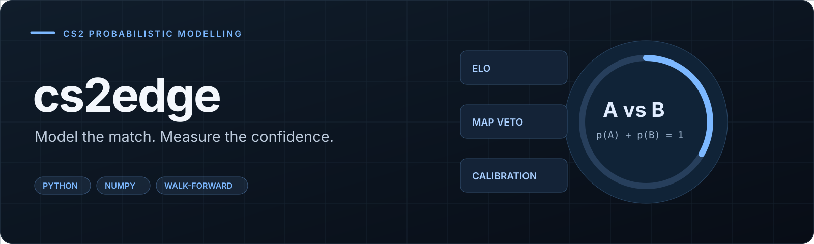

# cs2edge

**A CS2 match model whose confidence can be checked.**

cs2edge turns map-level match history into pre-match probabilities, accounts for map-veto structure, selects predictions and records them for later evaluation. Its NumPy core implements the ratings, logistic model and calibration explicitly.

`Python` · `NumPy` · `Elo + logistic regression` · `Probability calibration` · `Walk-forward evaluation`

[Try it](#quick-start) · [Modelling](#inside-the-model) · [Evaluation](#evaluation) · [CLI and data reference](docs/REFERENCE.md)

> **Data status:** the included history is synthetic and supports reproducible examples and tests. Its scores do not establish performance on real professional matches or betting returns.

The [implemented improvements](docs/AMELIORATIONS_IMPLEMENTEES.md) cover chronological
validation, matching predictions to results, input validation and automated checks.
The [demo data notes](data/README.md) give the exact generation commands.
The [latest improvements](docs/NOUVEAUX_AXES_IMPLEMENTES.md) add rating fixes,
reusable analyzer snapshots and uncertainty intervals for backtests.

## Why this project is interesting

| Problem | Approach |
| :--- | :--- |
| **Strength changes over time** | Global and map-specific Elo with inactivity, uncertainty and optional roster context. |
| **A series depends on the veto** | Model map picks and the resulting score distribution instead of treating every map as interchangeable. |
| **A predicted winner can still be overconfident** | Fit ridge logistic regression with IRLS, then calibrate probabilities. |
| **Future information can leak into evaluation** | Extract features chronologically and evaluate later blocks after training on earlier ones. |
| **Some matches offer too little evidence** | Apply the same selective prediction rules in live reports and backtests. |

## Quick start

```bash
git clone https://github.com/Bdexez/Cs2edge.git
cd Cs2edge
python -m venv .venv
.venv/bin/pip install -e .

.venv/bin/cs2edge ratings --top 15
.venv/bin/cs2edge predict navi g2 --bo 3
.venv/bin/cs2edge slate --fixtures data/fixtures.csv
```

The shipped CSV is ready for a first run. `cs2edge sample` regenerates synthetic history; `cs2edge fixtures` creates example upcoming matches. An optional GBDT ensemble is available with `pip install -e ".[gbdt]"`.

Train once and reuse the complete analyzer:

```bash
.venv/bin/cs2edge train --no-gbdt --bundle models/analyzer.cs2edge
.venv/bin/cs2edge predict navi g2 --model models/analyzer.cs2edge
.venv/bin/cs2edge slate --model models/analyzer.cs2edge --fixtures data/fixtures.csv
```

The bundle includes both models, configuration and history. Future predictions
reuse the fitted models without the source CSV; historical dates rebuild from
earlier days. `--model` cannot be combined with training or data options.
GBDT bundles require the same scikit-learn version and must come from a trusted
source because their GBDT component uses Python pickle. `train --out` continues
to export the match model alone.

## Inside the model

| Stage | Implementation |
| :--- | :--- |
| **Normalize and group** | Align team names, map names and map-level rows into match series. |
| **Build past-only features** | Maintain ratings and map-strength history as matches are observed. |
| **Estimate and calibrate** | NumPy IRLS logistic regression, probability calibration and opposing-outcome symmetry. |
| **Model the series** | Project the veto and derive series-score probabilities. |
| **Select and record** | Generate explanations, abstain when rules require it and archive predictions in a journal. |

For opposing outcomes, the core enforces **p(A) + p(B) = 1**. Calibration asks a separate question: over many predictions, do announced probabilities match observed frequencies?

## Evaluation

```bash
.venv/bin/cs2edge backtest --by-year
.venv/bin/cs2edge tipster-backtest
.venv/bin/python -m unittest discover -s tests -v
```

The walk-forward report compares model variants with Elo and map-level baselines, using **log-loss, Brier score, calibration error and reliability bands**. Prediction accuracy alone does not describe the quality of a probability estimate.

It also reports a paired 95% interval for the log-loss gain over Elo, resampling
whole calendar blocks. Defaults are 1,000 draws and seven-day blocks; use
`--bootstrap-samples` and `--block-days` to change them. This interval describes
the evaluated period and does not establish performance under a different meta.

Journal a slate before results are known, then inspect it later:

```bash
.venv/bin/cs2edge slate --fixtures data/fixtures.csv --record data/journal.csv
.venv/bin/cs2edge settle --journal data/journal.csv
.venv/bin/cs2edge journal --journal data/journal.csv
```

Settlement uses results present in the history CSV. It is not a live score feed.
The journal also records abstentions and leaves ambiguous result matches pending.
Provide the optional `match_id` in fixtures to identify repeat encounters reliably.

Predictions default to today's date. A historical `--date` rebuilds the ratings
and models from earlier days; results from the requested day are excluded because
the input schema has no result-availability timestamps.

## Bring your own history

The input is a **map-level CSV** with match identifiers, dates, team names, map names and round scores. Optional fields add series format, LAN status, event tier, map order and roster context.

The application does not include a match scraper. See the [input schema and examples](docs/REFERENCE.md#plugging-in-your-own-data) before importing a real dataset.

## Code map

| Files | Responsibility |
| :--- | :--- |
| [`ratings.py`](cs2edge/ratings.py), [`features.py`](cs2edge/features.py) | Chronological ratings and feature extraction |
| [`model.py`](cs2edge/model.py), [`metrics.py`](cs2edge/metrics.py) | Estimation, calibration and scoring |
| [`snapshot.py`](cs2edge/snapshot.py) | Complete analyzer persistence and integrity checks |
| [`markets.py`](cs2edge/markets.py) | Veto and series-score distributions |
| [`backtest.py`](cs2edge/backtest.py), [`pronostic.py`](cs2edge/pronostic.py) | Evaluation and selective prediction rules |
| [`journal.py`](cs2edge/journal.py), [`cli.py`](cs2edge/cli.py) | Recorded predictions and command-line entry points |

Optional odds-based analysis, assumptions, calibration examples and the complete CLI guide are in the [technical reference](docs/REFERENCE.md). Real-world validation needs a representative chronological dataset; missing roster or event context limits the model's information.
